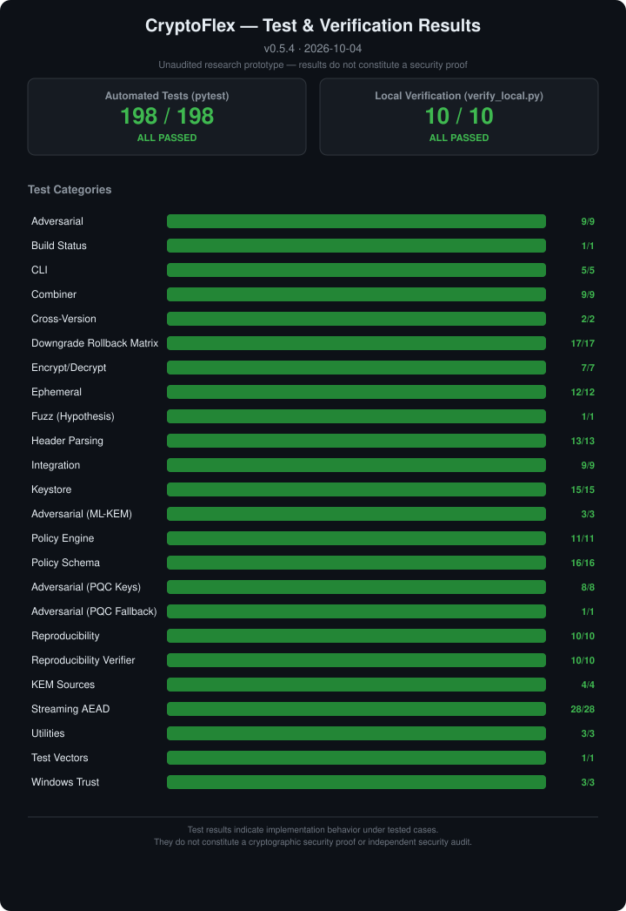

# cryptoflex

[](https://github.com/keerthivasan-sankar/crypto_flex/actions/workflows/tests.yml)
[](https://github.com/keerthivasan-sankar/crypto_flex/actions/workflows/build-wheels.yml)
[](LICENSE)
[](pyproject.toml)

Version: 0.5.5
Status: RELEASE CANDIDATE / research prototype

A local-first crypto-agility policy engine for Python.

`cryptoflex` sits between your application and its cryptographic primitives. It selects the strongest combination of classical (X25519) and post-quantum (ML-KEM via [liboqs](https://github.com/open-quantum-safe/liboqs)) algorithms that the current machine can support, then hands you a single root key — without ever making a network call.

> **Status:** security-hardened research prototype. CryptoFlex v0.5.5 has undergone maintainer-led security hardening, technical reviews, and supply-chain integrity verification covering its cryptographic API boundaries, hybrid key-combination design, header authentication, downgrade protection, streaming integrity, keystore protection, memory-handling practices, adversarial testing, and reproducible build and SBOM verification. This review is not an independent third-party security audit or formal cryptographic proof. The project remains prepared for further independent security review.
>
> The historical [`TECHNICAL_REVIEW_1.md`](TECHNICAL_REVIEW_1.md) is a v0.1.0 AI-assisted self-review and should not be treated as the security assessment of v0.5.5. Current security posture, format specification, and threat model are documented in [`SECURITY_HARDENING.md`](SECURITY_HARDENING.md), [`docs/FORMAT_SPECIFICATION.md`](docs/FORMAT_SPECIFICATION.md), and [`docs/THREAT_MODEL.md`](docs/THREAT_MODEL.md).

---

## Motivation

Most encryption tools are frozen to a single algorithm stack. When that stack ages — or when a large-scale quantum computer eventually threatens elliptic-curve math — every system built on it needs a coordinated migration. Signal, Chrome, and Cloudflare have already shipped hybrid classical+PQC key exchange at the protocol level. `cryptoflex` targets the tooling side of that same problem: local, offline applications — desktop utilities, backup tools, embedded devices — that have no equivalent solution today.

---

## Installation

```bash
# Classical-only (no native dependencies)
pip install cryptoflex

# With post-quantum support
pip install cryptoflex[pqc]
```

On Debian/Ubuntu, building `liboqs` from source is faster with:

```bash
sudo apt-get install -y liboqs-dev cmake ninja-build build-essential
pip install cryptoflex[pqc]
```

---

## Usage

### File encryption

```python
from cryptoflex import establish_keys, encrypt, decrypt

# Recipient generates a keypair once and shares the public bundle
recipient = establish_keys()

# Sender encrypts — only the recipient's private key can open this
ciphertext = encrypt(recipient.public_bundle, b"your plaintext here")

# Recipient decrypts
plaintext = decrypt(recipient.private_handles, ciphertext)
```

### Ephemeral messaging

**Per-message ephemeral keying:** Each message uses fresh sender-side ephemeral key material, preventing reuse of the sender's ephemeral secret across messages. This does not provide full forward secrecy against later compromise of the recipient's long-term private key.

```python
from cryptoflex import establish_keys, ephemeral_encrypt, ephemeral_decrypt

alice = establish_keys()

wire = ephemeral_encrypt(alice.public_bundle, b"hello")
plaintext = ephemeral_decrypt(alice.private_handles, wire)
```

### Keystore — saving keys to disk

Private keys are wrapped with Argon2id + AES-256-GCM before touching disk. Scrypt keystores from earlier versions are still importable.

```python
from cryptoflex import establish_keys, export_keyset_bytes, import_keyset_bytes

keyset = establish_keys()

# Encrypt and save
raw = export_keyset_bytes(keyset, "passphrase")  # Argon2id by default
with open("identity.cflk", "wb") as f:
    f.write(raw)

# Load and decrypt
with open("identity.cflk", "rb") as f:
    keyset = import_keyset_bytes(f.read(), "passphrase")
```

### Streaming large files

For files that do not fit in memory, `encrypt_stream` and `decrypt_stream` process data in 64 KB chunks. Each chunk is independently authenticated and bound to a sequence counter, so truncation and reordering are detected.

```python
from cryptoflex import establish_keys, encrypt_stream, decrypt_stream

keyset = establish_keys()

with open("archive.tar", "rb") as fin, open("archive.tar.cflx", "wb") as fout:
    encrypt_stream(keyset.public_bundle, fin, fout)

with open("archive.tar.cflx", "rb") as fin, open("archive.tar", "wb") as fout:
    decrypt_stream(keyset.private_handles, fin, fout)
```

### Crypto-Agility Migration Tooling

Re-encrypt existing `.cflx` files or stream payloads under a target `PublicBundle` (e.g., upgrading legacy `classical_only` ciphertexts to `hybrid_standard` PQC):

```python
from cryptoflex import establish_keys, migrate, migrate_stream

# Re-encrypt an in-memory blob to a new public bundle
migrated_blob = migrate(old_keyset.private_handles, old_blob, new_bundle)

# Re-encrypt a large file stream
with open("old.cflx", "rb") as fin, open("migrated.cflx", "wb") as fout:
    migrate_stream(old_keyset.private_handles, fin, fout, new_bundle)
```

### Wiping sensitive memory

```python
from cryptoflex import zeroize

buf = bytearray(key_material)
# ... use buf ...
zeroize(buf)  # overwrites in-place with 0x00
```

---

## CLI

```
cryptoflex keygen   --key identity.cflk --bundle identity.json [--kdf argon2id|scrypt]
cryptoflex encrypt  --in plain.dat  --out plain.cflx  --bundle identity.json [--stream]
cryptoflex decrypt  --in plain.cflx --out plain.dat   --key identity.cflk   [--stream]
cryptoflex migrate  --in old.cflx   --out new.cflx    --key identity.cflk --new-bundle new.json [--stream]
cryptoflex info     file.cflx
```

`keygen` defaults to Argon2id. Pass `--kdf scrypt` to produce a keystore compatible with v0.4.0 and earlier. Passwords are read from the `CRYPTOFLEX_PASSWORD` environment variable, or prompted interactively if neither that nor `--password` is set.

---

## Security profiles

The policy engine picks the strongest profile available at runtime. Profiles are evaluated in descending strength order; if `liboqs` is absent the engine falls back to the classical-only profile rather than failing.

| Profile | Components | Post-quantum |
|---|---|:---:|
| `hybrid_high` | X25519 + ML-KEM-1024 | Yes |
| `hybrid_standard` | X25519 + ML-KEM-768 | Yes |
| `classical_only` | X25519 | No |

To enforce a minimum: `decrypt(handles, blob, min_profile="hybrid_standard")`. This raises `DowngradeError` before any cryptographic operation if the ciphertext was produced under a weaker profile.

---

## Design notes

**Combiner.** The design is intended to combine the component secrets using HKDF-SHA384 with injective length-prefixed encoding and a fixed CryptoFlex domain-separation context. This is a project-specific construction requiring independent cryptographic review; the repository does not claim a formal security proof.

**Header integrity.** The full serialized header is passed as Associated Data to AES-256-GCM. Any modification to algorithm identifiers, the nonce, or the ciphertext components causes decryption to fail before the payload is touched.

**Error surface.** All decryption failures — wrong key, corrupted header, tampered ciphertext, authentication failure — surface as a single `DecryptionError`, reducing error-type disclosure. This should not be interpreted as a guarantee of constant-time behavior or complete side-channel resistance.

**Password hardening.** Keystore wrapping uses Argon2id (m=32 MB, t=3, p=1) by default, or Scrypt (N=2¹⁷, r=8, p=1) for compatibility. The algorithm is stored in the file header so the right KDF is always used on import.

For complete technical details, see:
- [Format & Cryptographic Specification](docs/FORMAT_SPECIFICATION.md)
- [Threat Model & Security Analysis](docs/THREAT_MODEL.md)
- [Packaging & Supply Chain Distribution](docs/PACKAGING.md)

---

## Testing

CryptoFlex maintains automated test suites covering cryptographic operations, policy enforcement, authenticated header validation, keystore handling, streaming AEAD integrity, adversarial inputs, property-based cases (Hypothesis), migration, and SBOM validation.

In GitHub Actions CI (`.github/workflows/tests.yml`), the test suite is validated across Python 3.10, 3.11, and 3.12, including:
- A fast matrix test job running unit, integration, adversarial, and SBOM verifier tests with `CRYPTOFLEX_DISABLE_PQC=1`.
- A real PQC test job (`test-with-real-pqc`) running on Python 3.12 that builds the native C `liboqs` library from source (pinned commit `5a1a854b0dc9f2141bdc771c555ee60c37950183`, tag 0.16.0), installs `liboqs-python==0.16.0`, and validates the full suite with native post-quantum primitives active.
- A reproducibility verification job running `scripts/verify_reproducibility.py`.

```bash
pip install -e ".[dev]"

# Without liboqs installed:
CRYPTOFLEX_DISABLE_PQC=1 pytest -v

# With liboqs installed (full PQC suite):
pytest -v

# End-to-end verification script:
python verify_local.py
```

### Validation Results

CryptoFlex includes automated tests covering cryptographic operations, policy enforcement, header validation, keystore handling, streaming integrity, adversarial cases, and integration behavior. The following visualization reflects locally executed validation results.

<p align="center">
  
</p>

> Test results indicate implementation behavior under the tested cases; they do not constitute a cryptographic security proof or independent security audit.

To regenerate this graph from the actual test suite:

```bash
python scripts/generate_validation_graph.py
```

### Reproducibility Scope

CryptoFlex builds are reproducible within the controlled GitHub Actions build environment using the pinned build toolchain (`pip==26.2.1`, `setuptools==84.0.0`, `wheel==0.48.0`, `build==1.6.0`) and isolated build environments. The release hard gate verifies:
- deterministic wheel output within the controlled build procedure
- deterministic raw sdist output within the controlled build procedure
- parity between the verifier rebuild and the release-run reference artifacts

This verification reflects **controlled in-pipeline reproducibility** on GitHub Actions runners. It does **not** constitute:
- independent multi-machine reproduction
- an independent cryptographic audit
- a formal supply-chain security certification

The repository provides a documented procedure for independent multi-machine reproduction in [docs/PACKAGING.md](docs/PACKAGING.md#3-independent-multi-machine-reproduction-procedure) and a reproduction helper in [`scripts/reproduce_release.py`](scripts/reproduce_release.py). Independent reproduction is considered demonstrated only when an external machine/environment produces matching artifacts for the specified release.

---

## Supply Chain & Software Bill of Materials (SBOM)

CryptoFlex enforces strict supply-chain security controls during candidate package builds (`.github/workflows/build-wheels.yml`):

- **CycloneDX 1.5 JSON SBOMs:** Two distinct runtime SBOMs are generated directly from isolated runtime environments installing the built wheel:
  - `dist/SBOM.json` — Base Runtime SBOM (classical runtime dependencies).
  - `dist/SBOM-pqc.json` — PQC Runtime SBOM (runtime dependencies including `liboqs-python`).
- **Deterministic Normalization (`scripts/normalize_sbom.py`):** Strips non-runtime installer/bootstrap packages (`pip`, `setuptools`, `wheel`) and establishes explicit empty dependency arrays (`"dependsOn": []`) for terminal leaf components. Refuses normalization if any non-bootstrap package depends on a bootstrap package.
- **Fail-Closed Verifier (`scripts/verify_sbom.py`):** Validates both SBOMs against the official CycloneDX 1.5 JSON Schema (Draft-07), enforces unique `bom-ref` identifiers, verifies complete dependency graph connectivity from root without orphans, confirms required direct runtime dependencies, and performs two-way set reconciliation against the target virtual environments via `pip list --format=json`.
- **Integrity Manifests & Provenance:** Generates `dist/SHA256SUMS.txt` for all release artifacts and creates cryptographic build provenance attestations via GitHub Actions (`actions/attest-build-provenance`).

For complete details, see [Software Bill of Materials (SBOM)](docs/SBOM.md) and [Packaging & Supply Chain Distribution](docs/PACKAGING.md).

---

## Academic Reference

### v0.5.4 Publication

The security-hardened v0.5.4 release is described in the following paper:

- **cryptoflex v0.5.4: A Security-Hardened Local-First Crypto-Agility Policy Engine for Hybrid Classical and Post-Quantum Key Exchange**
  Keerthivasan Sankar. Figshare, 2026.
  [https://figshare.com/articles/conference_contribution/_b_cryptoflex_v0_5_4_A_Security-Hardened_Local-First_Crypto-Agility_Policy_Engine_for_Hybrid_Classical_and_Post-Quantum_Key_Exchange_b_/34046034](https://figshare.com/articles/conference_contribution/_b_cryptoflex_v0_5_4_A_Security-Hardened_Local-First_Crypto-Agility_Policy_Engine_for_Hybrid_Classical_and_Post-Quantum_Key_Exchange_b_/34046034)

This paper covers the v0.5.4 security hardening, authenticated header format v2, streaming AEAD integrity, Argon2id keystore protection, hybrid combiner design, adversarial testing, and reproducible build verification.

### Earlier Architecture Paper (Historical Reference)

The original v0.1.0-era architecture and policy engine design are described in:

- **cryptoflex: A Local-First Crypto-Agility Policy Engine for Hybrid Classical and Post-Quantum Key Exchange**
  Keerthivasan Sankar. Figshare, 2026.
  [https://figshare.com/articles/journal_contribution/cryptoflex_A_Local-First_Crypto-Agility_Policy_Engine_for_Hybrid/33297369](https://figshare.com/articles/journal_contribution/cryptoflex_A_Local-First_Crypto-Agility_Policy_Engine_for_Hybrid/33297369)

> **Note:** This earlier paper reflects an early architecture of the project. The codebase has since evolved significantly — including authenticated headers, Argon2id KDF, memory zeroization, streaming AEAD, and ephemeral messaging — which are not covered in the original manuscript. It should not be treated as the security or design assessment for v0.5.4.

---

## License

MIT. See [LICENSE](LICENSE).

## Documentation Links

- [Security Hardening Evidence](SECURITY_HARDENING.md)
- [Security Policy](security.md)
- [Changelog](CHANGELOG.md)
- [Software Bill of Materials (SBOM)](docs/SBOM.md)
- [Packaging & Supply Chain Distribution](docs/PACKAGING.md)
- [Format & Cryptographic Specification](docs/FORMAT_SPECIFICATION.md)
- [Threat Model & Security Analysis](docs/THREAT_MODEL.md)
